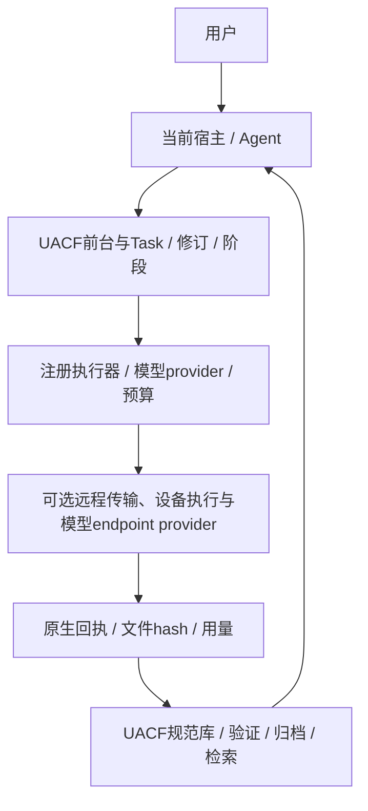

# 当前 UACF 架构 / Current architecture — 2026-10-21

UACF（Unified Agentic Continuity Fabric）拥有长期任务与资产的规范状态。它不只是给其他系统提供一份授权检查，也不只是聊天记忆库。

| 责任 | UACF 当前实现 | 外部基础设施边界 |
|---|---|---|
| 用户要求 | TaskContract、修订、命令台账、来源与纠正 | 不从工具输出获得新的用户授权 |
| 工作组织 | 既有前台、阶段计划、当前宿主接续、显式执行路线 | 不另建一个竞争的任务主记录 |
| 模型执行 | 注册provider、明确预算、用量与未知结果账本 | 网络传输不决定用哪个模型、不直接读宿主密钥 |
| 主机接入 | Codex/DSH/Pi/Claude适配器、MCP、公开观察与工具入口检查 | 安装配置、宿主加载、实际调用分开验证 |
| 资产 | 来源原件、不可变修订、Artifact、统一检索和ACL | 文件搬运不自动导入、归纳、采纳或改变归属 |
| 学习 | 来源绑定的知识/问题候选、比较、条件与复用 | 候选不自动变成事实、执行规则或权限 |
| 证据与验收 | 原生locator、内容hash、注册Validation、交付检查 | 报告与自述不能伪造Validation |
| 安装与配置 | 既有命名条目、保存原配置、比较后回滚、内容寻址发布 | 新provider不能重写所有插件或抢占既有配置 |

外部远程Fabric可负责设备可达性、已有出口的受限控制、传输、固定远程动作、人工桌面入口以及模型endpoint的网络接通。UACF继续决定Task、语义阶段、模型选择、预算、资产归属和采纳。远程agent只记录传输/进程状态，不复制规范库或模型调度器。

## 最近一轮增加了什么

1. 所有宿主默认工作入口：固定模板登记真实原生会话、准备当前ready上下文，显式退出限定当前工作，不把沉默解释成退出。
2. 统一资产索引：旧GPT导出、宿主公开观察、原生会话快照与当前规范候选进入同一可重建检索；来源数量各自计量，不能相加冒充独立对话总数。
3. 工作中捕获：公开读取、受管轮询、adaptive触发和真实事件检查点，均保留实际覆盖标签；轮询不冒充实时hook。
4. 命令台账与复用：保留用户补充、纠正及来源；可选召回不能挤走当前强制要求。
5. 指标证据校验：为声明的工作速率/本地模型比较复算分子、分母、Token类别、来源hash与时间对齐；不把日历跨度当实际工作时间，不把缓存输入当本地输出速度。

## 有代码不等于所有场景可用

当前源码测试通过，并不证明所有宿主回调、任意工具、远程主机或新安装环境均已验证。当前受管Codex observer仍要求会话cwd等于资料根，其他工作目录的会话会拒绝；自动入场的空验收模板没有适用验证项时，正式结算会被拒绝；Task修订后旧阶段计划不能继续使用。这些缺口保持可见，不能靠手工Artifact或改传cwd绕过。

模型endpoint桥接必须作为UACF注册provider调用，不另写可读宿主API密钥的模型客户端。远程传输层的认证是设备操作安全边界，不是新的用户任务或模型预算授权。

English: UACF owns canonical tasks, revisions, stages, provider routing, budgets, asset provenance and adoption. Remote connectivity or endpoint bridges are constrained providers, not competing orchestration, plugin-management or archive systems. Native observation, local transport receipts and registered validation are different evidence classes. Source availability is not universal runtime acceptance.
